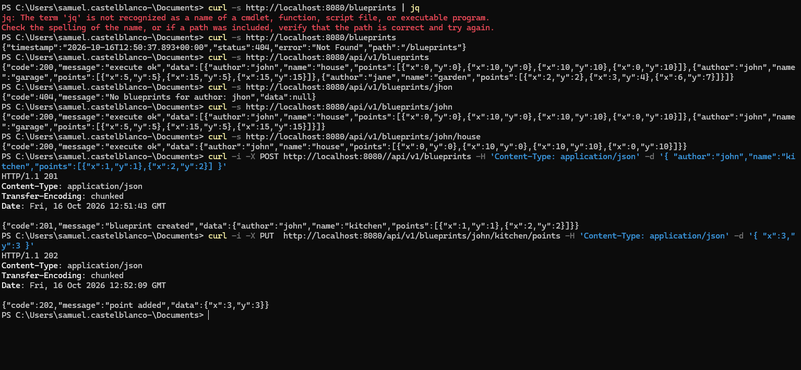
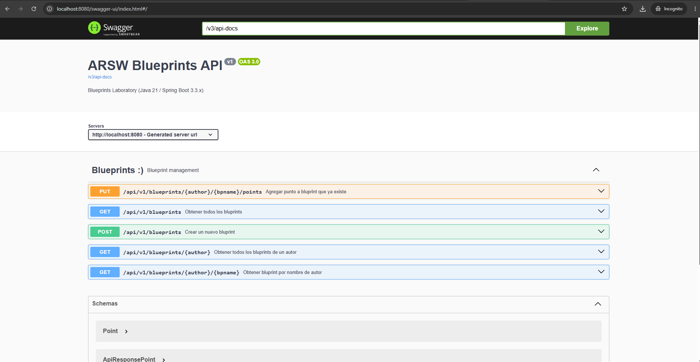

## Parcial Práctico Corte 2 – REST API Blueprints (Java 21 / Spring Boot 3.3.x)
# Escuela Colombiana de Ingeniería – Arquitecturas de Software  

---

## 📋 Requisitos
- Java 21
- Maven 3.9+

## ▶️ Ejecución del proyecto
```bash
mvn clean install
mvn spring-boot:run
```
Probar con `curl`:
```bash
curl -s http://localhost:8080/blueprints | jq
curl -s http://localhost:8080/blueprints/john | jq
curl -s http://localhost:8080/blueprints/john/house | jq
curl -i -X POST http://localhost:8080/blueprints -H 'Content-Type: application/json' -d '{ "author":"john","name":"kitchen","points":[{"x":1,"y":1},{"x":2,"y":2}] }'
curl -i -X PUT  http://localhost:8080/blueprints/john/kitchen/points -H 'Content-Type: application/json' -d '{ "x":3,"y":3 }'
```

Abrir en navegador:  
- Swagger UI: [http://localhost:8080/swagger-ui.html](http://localhost:8080/swagger-ui.html)  
- OpenAPI JSON: [http://localhost:8080/v3/api-docs](http://localhost:8080/v3/api-docs)  

---

## 🗂️ Estructura de carpetas (arquitectura)

```
src/main/java/edu/eci/arsw/blueprints
  ├── model/         # Entidades de dominio: Blueprint, Point
  ├── persistence/   # Interfaz + repositorios (InMemory, Postgres)
  │    └── impl/     # Implementaciones concretas
  ├── services/      # Lógica de negocio y orquestación
  ├── filters/       # Filtros de procesamiento (Identity, Redundancy, Undersampling)
  ├── controllers/   # REST Controllers (BlueprintsAPIController)
  └── config/        # Configuración (Swagger/OpenAPI, etc.)
```

> Esta separación sigue el patrón **capas lógicas** (modelo, persistencia, servicios, controladores), facilitando la extensión hacia nuevas tecnologías o fuentes de datos.

---

## 📖 Actividades del parcial

### 1. Buenas prácticas de API REST (Path)
- Cambia el path base de los controladores a `/api/v1/blueprints`.  

### 2. Buenas prácticas de API REST (Errores Http)
- Usa **códigos HTTP** correctos:  
  - `200 OK` (consultas exitosas).  Todas las peticiones GET.
  - `201 Created` (creación).  La peticioón POST.
  - `202 Accepted` (actualizaciones).  La petición PUT.
  - `400 Bad Request` (datos inválidos). Peticiones POST y PUT. 
  - `404 Not Found` (recurso inexistente o no se encuentra la data solicitada). Peticiones GET y PUT.
### 3. Buenas prácticas de API REST (Respuesta estandar)
- Implementa una clase genérica de respuesta uniforme:
  ```java
  public record ApiResponse<T>(int code, String message, T data) {}
  ```
  Ejemplo JSON:
  ```json
  {
    "code": 200,
    "message": "execute ok",
    "data": { "author": "john", "name": "house", "points": [...] }
  }
  ```

### 4. OpenAPI / Swagger
- Configura `springdoc-openapi` en el proyecto.  
- Expón documentación automática en `/swagger-ui.html`.  
- Actualiza la documentación de los endpoints con `@Operation` y `@ApiResponse` de todos los métodos del controler.


## ✅ Entregables

1. Repositorio en GitHub con:  
   - Código fuente actualizado.
   - Swagger/OpenAPI habilitado.  
   - Clase `ApiResponse<T>` implementada.


## Pruebas exitosas jeje 👯‍♀️


## Swagger

